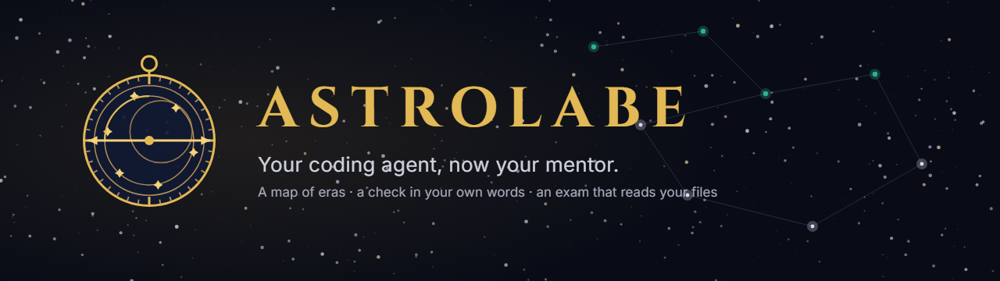
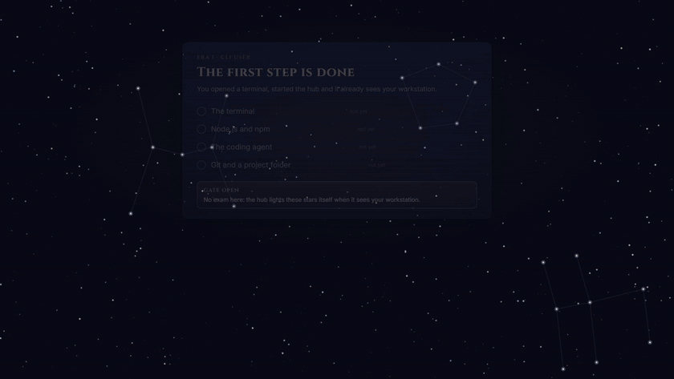

<p align="center">
  <picture>
    <source media="(prefers-color-scheme: light)" srcset="docs/media/banner-en-light.png">
    
  </picture>
</p>

<p align="center"><b>Your coding agent, now your mentor.</b><br>
A map of eras, a check in your own words, an exam that reads your files. Free, open, on your computer.</p>

<p align="center">
  <a href="#start-here-if-you-have-never-used-a-terminal">Start here</a> ·
  <a href="#how-it-works">How it works</a> ·
  <a href="#build-your-own-pack">Build a pack</a> ·
  <a href="#security">Security</a> ·
  <a href="README.ru.md">Русский</a>
</p>

<p align="center">
  <a href="https://github.com/criocore/astrolab/actions/workflows/ci.yml"></a>
  
  
  
  
  
  
  
  
</p>

<p align="center">
  
</p>

<p align="center"><a href="https://criocore.github.io/astrolab/media/astrolabe-45s-en.mp4">Watch the 45-second film</a> · <a href="https://criocore.github.io/astrolab/media/astrolabe-45s-ru.mp4">по-русски</a></p>

```
git clone https://github.com/criocore/astrolab.git
cd astrolab
start.cmd        # Windows
./start.sh       # macOS, Linux: written, not yet run by anyone, reports welcome
```

Add `--demo` to either command to try the hub on recorded answers without an agent.

## The mentor is already installed on your machine

Claude Code, Codex CLI and Gemini CLI sit in the terminals of people who write code. Each of them can read a folder and answer a question in plain language. Astrolabe does not add another model or ask for a key: it runs the CLI you already signed in to, on your subscription, on your machine. That is the whole base this project stands on.

## Learning alone, nobody checks you

A course ends with a certificate. A chat answers whatever you ask and rarely asks back. A roadmap is a list you tick yourself. None of them opens your repository and says which part is missing. The result is familiar: a lot read, little proven, and no idea whether you are ready for the next step.

| Way to learn | Gives you a map | Checks your understanding | Checks what you built | Who checks |
|---|---|---|---|---|
| Roadmaps | yes | you tick the boxes | no | you |
| Video courses | yes | a quiz | sometimes | the platform |
| Chat with a model | no | only if you ask | no | nobody by default |
| A human mentor | sometimes | yes | yes | a person, when available |
| **Astrolabe** | yes, eight eras | yes, in your own words, with a quote | yes, every claim traced to a file | your own coding agent, verified by the hub |

## How it works

<table>
<tr>
<td width="50%" valign="top"><br><b>A map, not a pile.</b><br>Eight eras, from a working terminal to an AI architect in a team. Inside an open era you go in any order; the next era opens after the current one is passed.</td>
<td width="50%" valign="top"><br><b>Your words, quoted.</b><br>A topic check is two or three questions on the topic's criteria. The verdict is "accepted" or "gap" and always carries a quote from your answer, so vague phrases do not pass.</td>
</tr>
<tr></tr>
<tr>
<td width="50%" valign="top"><br><b>Your work, checked for real.</b><br>An era ends with a project folder. The agent must back every rubric item with a file and an exact quote; the hub then opens that file itself and looks for the quote. No quote, no verdict, or a path outside the folder: not passed, whatever the agent wrote.</td>
<td width="50%" valign="top"><br><b>Your own agent, no keys.</b><br>The hub stores no credentials and calls no model. Every check is one normal call of your CLI.</td>
</tr>
</table>

<p align="center"></p>

## Your journey

```
start the hub        Era I lights up        read, then answer       hand in a folder        next era opens
      │                    │                      │                        │                     │
  terminal, Node,    probes see your         2–3 questions,          5–8 rubric items,     the gate of the
  git, agent found   workstation, no AI     verdict with a quote   quotes verified in    passed era turns
                     needed                 from your answer       files by the hub       teal
```

**1. Era I lights itself.** On the first start the hub checks your terminal, Node, git and the agent and lights those stars for you. No exam here. The era's gate is open from the beginning, and inside it is the workstation log with a "Check the agent call" button.

<p align="center"></p>

**2. A topic check.** Open a topic, read the materials, press "Check". Answer in your own words. Each answer comes back with a verdict, the quote it was counted for, and, on a gap, the material that closes it.

**3. An era gate.** Build the era's project, point the hub at the folder, submit. You get a row per rubric item: yes or no, the file, the quote, and "found in file" from the hub's own search. One gap means not passed yet, with the gap named.

<p align="center"></p>

**4. The next era.** Passed gates open the next era. The sky fills star by star: one star per topic, lit when learned.

The films were made with the `/brag` skill for Claude Code and [Hyperframes](https://hyperframes.heygen.com) from the app's own code and palette; the rubric in the films is shortened to fit the screen. Music: Sascha Ende, [ende.app](https://ende.app/en), CC BY 4.0.

## Each check is a call of your own agent

The hub itself sends nothing anywhere; the only network traffic is what your CLI exchanges with its own provider. A topic check is one call for the questions and one per answer, all without tools. An era gate is one call where the agent may only read the folder you named. A malformed reply is retried once. The cost is the same as asking the agent yourself, and the log in `data/logs/mentor.jsonl` keeps one line per call, without the text of your answers. The whole exam folder goes to your CLI's model provider, so keep keys and `.env` files out of it.

## What works today and what comes next

| Part | Today (verified) | Next |
|---|---|---|
| Topic check | Claude Code, live; verdicts with quotes checked against the answer | recordings for a demo of more topics |
| Era gate | quotes verified in files by the hub; demo folder with a deliberate gap | a deed per topic: one file or one command output the hub can confirm |
| Era I | four probes (terminal, Node, git, agent), two topics ticked by hand | "check the call" on the first-run screen, custom CLI on screen |
| Agents | Claude Code run live; Codex CLI and Gemini CLI set up from their docs | live runs of Codex and Gemini, an opencode adapter |
| Pack "AI Engineer" | 8 eras, 13 adjacent areas, 172 topics, 660 open materials with checked dates | monthly link check in CI, YAML sources |
| Chronicle and Rutter | notes, technology radar and ADRs beside the program | an automatic feed of events; decisions stored as files in your repository |
| Platforms | Windows, checked end to end; tests, pack check and build pass in CI on Ubuntu and macOS | macOS and Linux: `start.sh` is written but has not been run by a person yet |

Grade names in the pack (Junior, Middle, Senior, Lead) are rungs of this program, not a qualification. Hours are the pack author's estimate.

## Build your own pack

The curriculum is data. A pack is a folder of JSON: eras, topics with criteria, materials with a license field, rubric items for each gate. The hub is the engine and does not care what the subject is. The format is described in [docs/pack-format.md](docs/pack-format.md); `npm run check:pack` validates criterion coverage, repeats and consent for channel sources.

## Where this goes, and what would help

Version 0.1 is the first public cut. It would help most if someone:

- ran `./start.sh` on macOS or Linux and opened an issue with what happened;
- ran a topic check or a gate with Codex CLI or Gemini CLI and reported the output;
- reported a dead or paywalled link with the "Dead link" issue template;
- wrote a pack for another field.

A star tells the author the map is wanted. Contributing rules: [CONTRIBUTING.md](CONTRIBUTING.md).

---

## Start here (if you have never used a terminal)

This is Era I of the program, written out in full. Do the steps in order; after each install, close the terminal and open a new one, otherwise the new command is "not found". When the hub starts, it checks these steps itself and lights the stars of Era I for you.

1. **Open a terminal.** Windows: press Win, type `terminal`, open Terminal (or PowerShell). macOS: Cmd+Space, type `terminal`. Linux: Ctrl+Alt+T. Type `pwd` and press Enter: the current folder is printed.
2. **Install Node.js 22 or newer** from [nodejs.org/en/download](https://nodejs.org/en/download) (the LTS installer for your system). New terminal, then:
   ```
   node -v
   ```
   must print `v22.13.0` or higher.
3. **Install git** from [git-scm.com/downloads](https://git-scm.com/downloads/) (on macOS `git --version` offers to install it). New terminal, `git --version` prints a version.
4. **Install one coding agent** and sign in. Pick the one you have an account with:
   - Claude Code: [setup guide](https://code.claude.com/docs/en/setup), then `claude --version` and `claude` to sign in.
   - Codex CLI: [install guide](https://learn.chatgpt.com/docs/codex/cli), then `codex --version` and `codex` to sign in.
   - Gemini CLI: [install guide](https://geminicli.com/docs/get-started/installation/), then `gemini --version` and `gemini` to sign in.

   Ask the agent something simple in the terminal and get an answer. The hub keeps no keys: every check runs through this CLI on your subscription or key.
5. **Get the hub.** In the terminal:
   ```
   git clone https://github.com/criocore/astrolab.git
   cd astrolab
   ```
   then `start.cmd` on Windows or `./start.sh` on macOS and Linux. The first start installs dependencies and builds the interface (a minute or two), then opens http://127.0.0.1:4317 in the browser.
6. **Look at Era I.** The hub asks for the language and the agent, then shows the tree of eras. Era I "CLI user" is already mostly lit: the hub saw your terminal, Node, git and the agent. Its gate is open and pulsing; inside is the workstation log with a "Check the agent call" button (one short call, shows "not signed in" if that is the case) and two topics to tick by hand. Era II starts the actual program.

<p align="center"></p>

No agent yet? `start.cmd --demo` (or `./start.sh --demo`) runs the hub on recorded answers so you can see how a check and a gate work.

## Quick start for developers

You need Node.js 22.13+ (built-in `node:sqlite`) and one coding agent CLI for the mentor: Claude Code, Codex CLI or Gemini CLI (see "Agents").

```
npm install
npm run build:pack   # builds packs/ai-engineer.json from packs/src
npm run build        # web interface
npm start            # http://127.0.0.1:4317
```

Or just `start.cmd` (Windows) and `./start.sh` (macOS, Linux). Version 0.1 was run and checked on Windows only; `start.sh` and the macOS/Linux paths have not been exercised yet, so a report or a fix from those systems is welcome. On the first run the hub asks for the language, the agent, its model and effort level; all of it can be changed later in the settings menu.

`start.cmd --demo` runs the hub without an agent: the mentor's answers come from recordings in `fixtures/mentor`, progress goes to a separate `data-demo/` folder. For the Era II demo exam point it at `fixtures/exam-g0-demo`: a deliberately incomplete artifact (the code is there, the cost calculation is not), which shows how the gate confirms quotes against files and where it marks a gap. In the mentor panel the demo has a recorded "Explain" for "How an LLM works"; other panel requests say there is no recording, the demo never starts a CLI.

Development: `npm run dev:server` and `npm run dev:web` (Vite on :5173 proxies /api). Tests: `npm test` (no live agent needed). Pack check: `npm run check:pack`.

## The rules

1. **Era** = core topics + levels of adjacent areas attached to it. The next era is locked until the current era's exam is passed. This is the only lock rule: inside an open era topics go in any order, adjacent levels are checked separately and are not a lock condition. Era I (workstation setup) has no exam: the hub lights its stars itself by checking Node, git and the agent, and Era II is open from the start.
2. **Topic**: a goal, 2–5 checkable criteria, materials with a rubric (understand / do, minutes, access, terms of use). Repeated materials are marked "you already covered this". Tracks (python / typescript) switch in the settings menu.
3. **Topic check**: the mentor writes 2–3 questions on the criteria, you answer in your own words, the mentor returns "accepted" or "gap" with a quote from your answer and the material that closes the gap. All questions accepted → topic learned.
4. **Era gate** and **level check**: you give a folder with an artifact (a repository, a report). The agent only reads it, writes nothing and runs nothing. The gate rubric is 5–8 checks from the pack (`checks`), each with a verdict, a file and an exact quote. The hub opens the named file and searches for the quote: not found, a check without a verdict, or a path outside the folder means not passed. Gate passed → the next era opens.
5. **Chronicle, Rutter** (technology radar and ADRs): your notes beside the program.

<details>
<summary><b>Environment variables</b></summary>

| Variable | What it does |
|---|---|
| `STUDY_HUB_PACK` | path to a pack instead of the first one in `packs/` |
| `STUDY_HUB_DATA` | progress folder (default `data/`) |
| `STUDY_HUB_PORT` | port (4317) |
| `STUDY_HUB_LANG` | default language, `en` (default) or `ru`: the interface starts in it until a language is chosen on the first run (the choice is kept in the browser), and the mentor uses it for API requests without a language |
| `MENTOR_MODE` | `live` (default), `record` (calls the agent and writes recordings), `replay` (recordings only) |
| `STUDY_HUB_DEMO=1` | replay + `data-demo/` |
| `STUDY_HUB_PRESET` | agent preset from `agents.json` (overrides the choice in `data/agents.local.json`) |

</details>

<details>
<summary><b>Agents: presets, read-only boundaries, model and effort</b></summary>

The mentor and the examiner is your own coding agent. The hub keeps no keys and never calls a model itself: it runs a CLI that is already installed and signed in on your machine. Presets live in `agents.json`, the default choice in `data/agents.local.json` (`{"default": "codex"}`); `GET /api/agents` shows which CLIs are found in PATH (only `<cli> --version` is run: no sign-in, no model call).

| Preset | CLI | Topic check | Exam on a folder: how read-only is enforced | Mentor panel |
|---|---|---|---|---|
| `claude` | Claude Code | `claude -p` without tools, response schema by flag | `--restricted`: file tools limited to the folder, Bash and writes disabled | streaming answer, conversation continues (`--resume`) |
| `codex` | Codex CLI | `codex exec --json`, schema as a file (`--output-schema`), web search disabled | `--sandbox read-only`: no writes, no network; Codex can read the whole file system, the folder boundary holds by the prompt only | whole answer after the turn, no conversation continuation |
| `gemini` | Gemini CLI | `gemini -p` with JSON output, schema inside the prompt | `--approval-mode plan`: read-only tools only (read_file, glob, grep_search, list_directory) and Google web search | streaming answer, conversation continues (`--resume`) |

Model and effort are chosen on the first run and in the settings menu; the choice is stored in `data/agents.local.json` under `options` and passed to the CLI as flags on every call (topic check, exam, mentor panel, terminal tab). Empty means the CLI's own default.

| Preset | Model | Effort |
|---|---|---|
| `claude` | `--model` (`fable`, `opus`, `sonnet` or a full model name) | `--effort low … max` |
| `codex` | `-m <model>` | `-c model_reasoning_effort="low … xhigh"` |
| `gemini` | `-m <model>` | no flag; thinking depth lives in the CLI's own settings |

The hub verifies exam quotes against files itself, so the verdict is honest with any agent; what differs is what the agent may read beyond the folder. Codex and Gemini flags were checked against the vendors' documentation on 2026-10-22; live runs were done with Claude Code only. Your own CLI or other flags: put `data/agents.local.json` with the same fields as `agents.json`; the local file overrides a preset field by field, arrays and `null` replace the value entirely.

</details>

<details>
<summary><b>Data and recordings</b></summary>

- Progress: SQLite `data/hub.db` (topics, checks, attempts, exams, chronicle, radar, ADRs). Export and import from the settings menu.
- Agent call log: `data/logs/mentor.jsonl`, one line per call, without prompt or answer text.
- Agent answer recordings: `fixtures/mentor/<sha256 of the request>.json`. Created in `record` mode, used instead of the agent in `replay`.

</details>

## Security

- The server listens on `127.0.0.1` only. Mutating requests require a session token and are checked for Host and Origin: a foreign page in your browser cannot change data or start the agent.
- Topic check (Claude Code) runs without tools (`--tools ""`), in safe mode and without MCP servers. The learner's answer is passed as data inside tags and escaped.
- Exam (Claude Code) runs in `--restricted`: file tools are limited to the artifact folder, Bash and writes are off, permission prompts are not asked and are declined automatically. For Codex and Gemini the boundary is described in the "Agents" table.
- The mentor panel (the "Explain", "Task" and free-question buttons) may fetch web pages and search the web with the Claude Code preset; topic checks and exams never do.
- Token spend is the same as a normal session of your subscription or key.
- The whole content of the exam folder goes to the model provider of your CLI, including secrets if they are there. Point it at a folder without keys and `.env` files.

See [SECURITY.md](SECURITY.md) for reporting.

## Contributors

- [@geibos](https://github.com/geibos) — v0.1.1: the mentor panel through the shared agent pipeline (logged, recorded, replayed in the demo, honestly stoppable), the whole process tree ended on Stop, one default language with saved answers keeping theirs, error codes always shown as phrases, follow-up recordings per topic. Thirteen issues and five pull requests on the project's first day.

This list is open, and good reports count as much as code: an issue with a reproduction like those above is a contribution too. Packs, adapters, fixes and reports from macOS and Linux are all welcome — see [CONTRIBUTING.md](CONTRIBUTING.md).

## Licenses

Code: MIT (`LICENSE`). Pack texts (topics, criteria, own texts): CC BY-SA 4.0. Linked materials belong to their authors under their own terms; see the `terms` field on each material. Credits to the channels that allowed linking to their posts: `packs/ai-engineer.credits.md`. The films use the track "Happy Beats / Business Moves vol. 12" by Sascha Ende, [ende.app](https://ende.app/en), CC BY 4.0. Claude Code, Codex CLI and Gemini CLI are products of Anthropic, OpenAI and Google; Astrolabe is an independent project and is not affiliated with any of them.

## A note from the author

Astrolabe was built by one person together with an AI coding agent (Claude Code), first for their own learning, and is shared in good faith. It is not a school, a certificate or a judgement of anyone's skills, and no harm to any author, vendor or learner is intended. If a link, a text or a name here is wrong or hurts someone's rights, open an issue and it will be fixed. Contributors are welcome: packs, adapters, fixes, reports from macOS and Linux.

<p align="center">Built with Claude Code · checked on Windows · <a href="README.ru.md">Русская версия</a></p>
