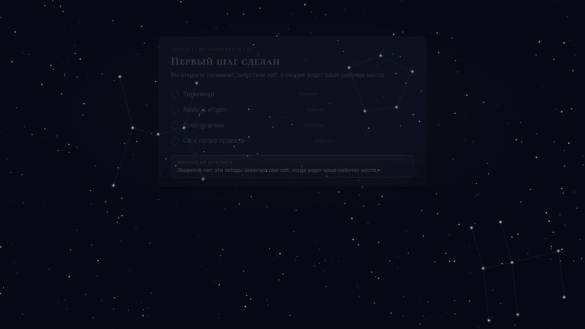
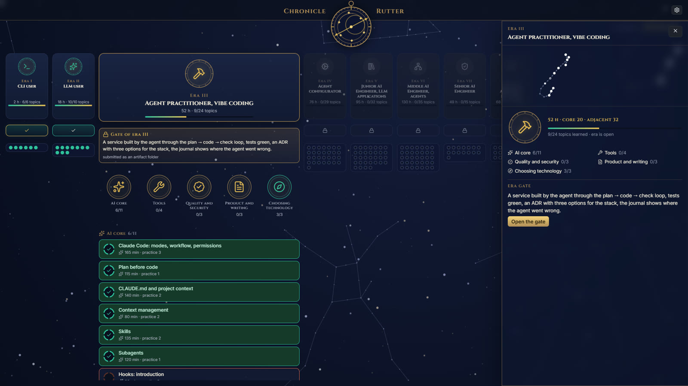
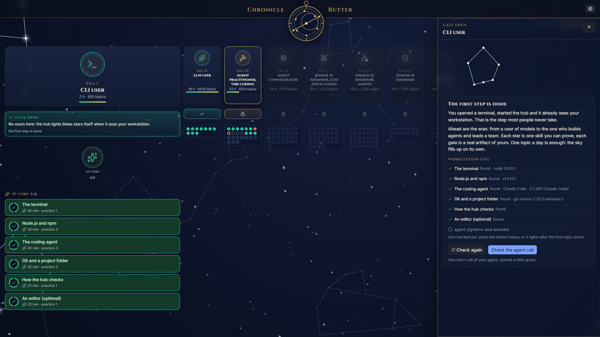
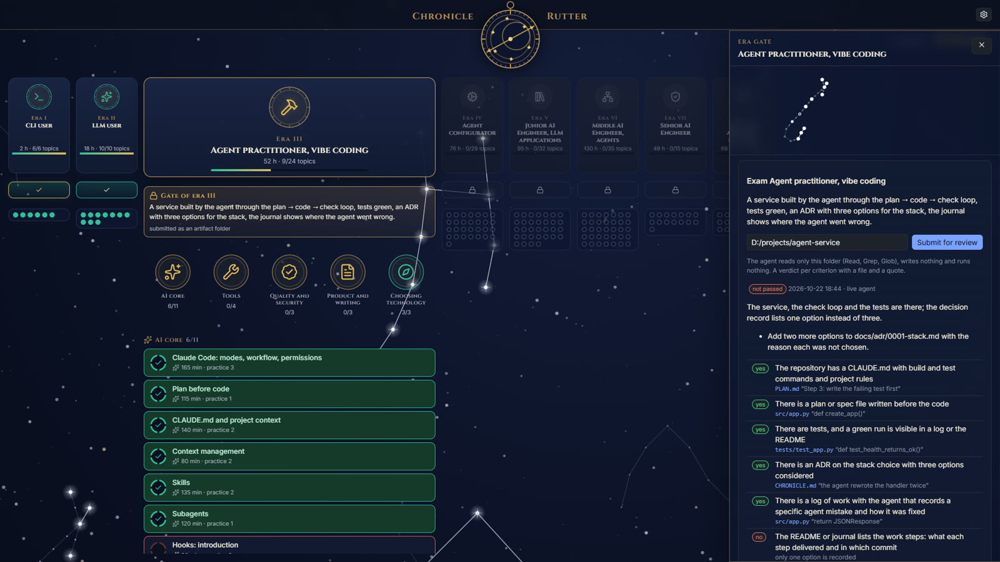
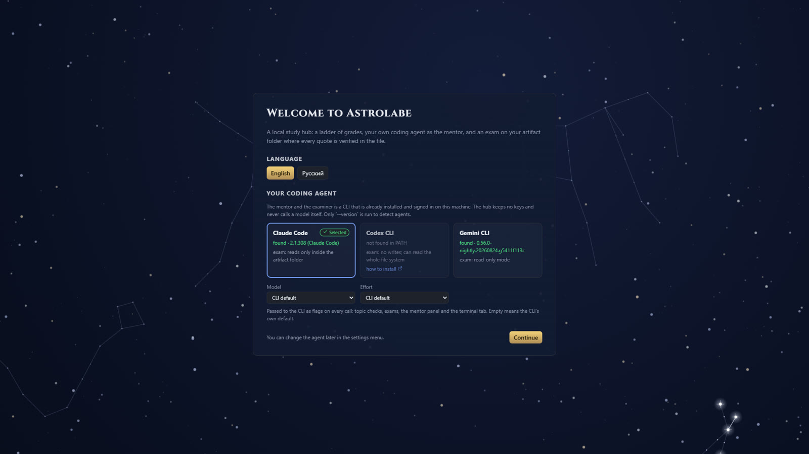

<p align="center">
  <picture>
    <source media="(prefers-color-scheme: light)" srcset="docs/media/banner-ru-light.png">
    
  </picture>
</p>

<p align="center"><b>Ваш coding-агент, теперь ваш наставник.</b><br>
Карта эпох, проверка своими словами, экзамен, который читает ваши файлы. Бесплатно, открыто, на вашем компьютере.</p>

<p align="center">
  <a href="#с-чего-начать-если-вы-никогда-не-открывали-терминал">С чего начать</a> ·
  <a href="#как-это-устроено">Как это устроено</a> ·
  <a href="#соберите-свой-пакет">Свой пакет</a> ·
  <a href="#безопасность">Безопасность</a> ·
  <a href="README.md">English</a>
</p>

<p align="center">
  <a href="https://github.com/criocore/astrolab/actions/workflows/ci.yml"></a>
  
  
  
  
  
  
  
  
</p>

<p align="center">
  
</p>

<p align="center"><a href="https://criocore.github.io/astrolab/media/astrolabe-45s-ru.mp4">Посмотреть 45-секундный ролик</a> · <a href="https://criocore.github.io/astrolab/media/astrolabe-45s-en.mp4">in English</a></p>

```
git clone https://github.com/criocore/astrolab.git
cd astrolab
start.cmd        # Windows
./start.sh       # macOS, Linux: написан, никем ещё не запускался, отчёты приветствуются
```

Добавьте `--demo` к любой из команд, чтобы попробовать хаб на записанных ответах без агента.

## Наставник уже установлен на вашей машине

Claude Code, Codex CLI и Gemini CLI стоят в терминалах у тех, кто пишет код. Каждый из них умеет прочитать папку и ответить на вопрос обычным языком. Астролябия не добавляет ещё одну модель и не просит ключ: она запускает тот CLI, в который вы уже вошли, по вашей подписке, на вашей машине. На этом и стоит весь проект.

## Учишься один, никто не проверяет

Курс заканчивается сертификатом. Чат отвечает на любой вопрос и редко спрашивает в ответ. Дорожная карта это список, который вы отмечаете сами. Никто из них не открывает ваш репозиторий и не говорит, чего в нём не хватает. Итог знаком: прочитано много, доказано мало, и непонятно, готовы ли вы к следующему шагу.

| Способ | Даёт карту | Проверяет понимание | Проверяет сделанное | Кто проверяет |
|---|---|---|---|---|
| Дорожные карты | да | галочки ставите сами | нет | вы |
| Видеокурсы | да | тест | иногда | платформа |
| Чат с моделью | нет | только если попросить | нет | никто по умолчанию |
| Живой наставник | иногда | да | да | человек, когда доступен |
| **Астролябия** | да, восемь эпох | да, своими словами, с цитатой | да, каждое утверждение привязано к файлу | ваш coding-агент, а хаб перепроверяет |

## Как это устроено

<table>
<tr>
<td width="50%" valign="top"><br><b>Карта, а не куча.</b><br>Восемь эпох, от работающего терминала до архитектора ИИ в команде. Внутри открытой эпохи порядок свободный; следующая открывается, когда пройдена текущая.</td>
<td width="50%" valign="top"><br><b>Ваши слова, в цитате.</b><br>Проверка темы это два-три вопроса по критериям темы. Вердикт «принято» или «пробел» всегда несёт цитату из вашего ответа, поэтому общие фразы не проходят.</td>
</tr>
<tr></tr>
<tr>
<td width="50%" valign="top"><br><b>Ваша работа, проверенная по-настоящему.</b><br>Эпоха заканчивается папкой с проектом. Агент обязан подтвердить каждый пункт рубрики файлом и точной цитатой; затем хаб сам открывает этот файл и ищет цитату. Нет цитаты, нет вердикта или путь вне папки: не сдано, что бы агент ни написал.</td>
<td width="50%" valign="top"><br><b>Ваш агент, без ключей.</b><br>Хаб не хранит учётных данных и не вызывает модели. Каждая проверка это один обычный вызов вашего CLI.</td>
</tr>
</table>

<p align="center"></p>

## Ваш путь

```
запуск хаба         эпоха I зажигается     прочитал, ответил       сдал папку              следующая эпоха
      │                    │                      │                        │                     │
  терминал, Node,    пробы видят рабочее     2–3 вопроса,            5–8 пунктов рубрики,   эволюция пройденной
  git, агент найден  место, ИИ не нужен     вердикт с цитатой      цитаты хаб сверяет    эпохи становится
                                            из вашего ответа       с файлами сам          бирюзовой
```

**1. Эпоха I зажигается сама.** При первом запуске хаб проверяет терминал, Node, git и агента и зажигает эти звёзды за вас. Экзамена здесь нет. Эволюция эпохи открыта с самого начала, внутри журнал рабочего места с кнопкой «Проверить вызов агента».

<p align="center"></p>

**2. Проверка темы.** Откройте тему, прочитайте материалы, нажмите «Проверить». Отвечайте своими словами. На каждый ответ приходит вердикт, цитата, за которую его засчитали, а при пробеле материал, который его закрывает.

**3. Эволюция эпохи.** Соберите проект эпохи, укажите хабу папку, сдайте. По каждому пункту рубрики строка: есть или нет, файл, цитата и «найдено в файле» от собственного поиска хаба. Один пробел означает «не сдано», и пробел назван.

<p align="center"></p>

**4. Следующая эпоха.** Пройденная эволюция открывает следующую эпоху. Небо заполняется звезда за звездой: одна звезда на тему, горит, когда тема изучена.

Ролики собраны скиллом `/brag` для Claude Code и [Hyperframes](https://hyperframes.heygen.com) из кода и палитры самого приложения; рубрика в роликах сокращена под экран. Музыка: Sascha Ende, [ende.app](https://ende.app/en), CC BY 4.0. Снимки экрана сделаны на английском интерфейсе; русский выглядит так же.

## Каждая проверка это вызов вашего собственного агента

Сам хаб никуда ничего не отправляет; единственный сетевой трафик это обмен вашего CLI с его провайдером. Проверка темы это один вызов за вопросы и по одному за каждый ответ, все без инструментов. Эволюция эпохи это один вызов, в котором агент может только читать названную вами папку. Испорченный ответ запрашивается повторно один раз. Цена такая же, как если бы вы спросили агента сами, а журнал `data/logs/mentor.jsonl` хранит по строке на вызов, без текста ваших ответов. Папка экзамена целиком уходит провайдеру модели вашего CLI, поэтому держите ключи и `.env` вне её.

## Что работает сегодня и что дальше

| Часть | Сегодня (проверено) | Дальше |
|---|---|---|
| Проверка темы | Claude Code, вживую; вердикты с цитатами сверяются с ответом | записи для демо большего числа тем |
| Эволюция эпохи | цитаты хаб сверяет с файлами сам; демо-папка с нарочным пробелом | дело на тему: файл или вывод команды, который хаб подтверждает сам |
| Эпоха I | четыре пробы (терминал, Node, git, агент), две темы отмечаются вручную | «проверить вызов» на экране первого запуска, свой CLI на экране |
| Агенты | Claude Code и Codex CLI прогнаны вживую; Gemini CLI настроен по документации | живой прогон Gemini, адаптер opencode |
| Пакет «ИИ-инженер» | 8 эпох, 13 смежных областей, 172 темы, 660 открытых материалов с датой проверки | ежемесячная проверка ссылок в CI, исходники в YAML |
| Хроника и Лоция | заметки, радар технологий и ADR рядом с программой | автоматическая лента событий; решения файлами в вашем репозитории |
| Платформы | Windows, проверено от начала до конца; тесты, проверка пакета и сборка проходят в CI на Ubuntu и macOS | macOS и Linux: `start.sh` написан, но человеком ещё не запускался |

Названия грейдов в пакете (Junior, Middle, Senior, Lead) это ступени этой программы, не квалификация. Часы это оценка автора пакета.

## Соберите свой пакет

Программа это данные. Пакет это папка с JSON: эпохи, темы с критериями, материалы с полем лицензии, пункты рубрики для каждой эволюции. Хаб это движок, и ему всё равно, какой предмет. Формат описан в [docs/pack-format.ru.md](docs/pack-format.ru.md); `npm run check:pack` проверяет покрытие критериев, повторы и согласие авторов каналов.

## Куда это идёт и чем помочь

Версия 0.1 это первый публичный срез. Больше всего помогло бы, если кто-нибудь:

- запустил `./start.sh` на macOS или Linux и завёл issue с тем, что получилось;
- прогнал проверку темы или эволюцию с Codex CLI или Gemini CLI и прислал вывод;
- сообщил о мёртвой или платной ссылке через шаблон issue «Dead link»;
- написал пакет для другой области.

Звезда на репозитории говорит автору, что карта нужна. Правила участия: [CONTRIBUTING.md](CONTRIBUTING.md).

---

## С чего начать (если вы никогда не открывали терминал)

Это эпоха I программы, расписанная целиком. Делайте шаги по порядку; после каждой установки закрывайте терминал и открывайте новый, иначе новая команда «не найдена». При запуске хаб сам проверит эти шаги и зажжёт за вас звёзды эпохи I.

1. **Откройте терминал.** Windows: нажмите Win, наберите `terminal`, откройте «Терминал» (или PowerShell). macOS: Cmd+Пробел, наберите `terminal`. Linux: Ctrl+Alt+T. Напечатайте `pwd` и нажмите Enter: напечатается текущая папка.
2. **Поставьте Node.js 22 или новее** с [nodejs.org/en/download](https://nodejs.org/en/download) (установщик LTS для вашей системы). Новый терминал, затем:
   ```
   node -v
   ```
   должно напечататься `v22.13.0` или больше.
3. **Поставьте git** с [git-scm.com/downloads](https://git-scm.com/downloads/) (на macOS `git --version` сам предложит установку). Новый терминал, `git --version` печатает версию.
4. **Поставьте один coding-агент** и войдите в аккаунт. Выберите тот, где у вас есть аккаунт:
   - Claude Code: [инструкция по установке](https://code.claude.com/docs/en/setup), затем `claude --version` и `claude` для входа.
   - Codex CLI: [инструкция по установке](https://learn.chatgpt.com/docs/codex/cli), затем `codex --version` и `codex` для входа.
   - Gemini CLI: [инструкция по установке](https://geminicli.com/docs/get-started/installation/), затем `gemini --version` и `gemini` для входа.

   Спросите агента в терминале что-нибудь простое и получите ответ. Хаб не хранит ключей: каждая проверка идёт через этот CLI по вашей подписке или ключу.
5. **Скачайте хаб.** В терминале:
   ```
   git clone https://github.com/criocore/astrolab.git
   cd astrolab
   ```
   затем `start.cmd` на Windows или `./start.sh` на macOS и Linux. Первый запуск ставит зависимости и собирает интерфейс (минута-две), потом открывает http://127.0.0.1:4317 в браузере.
6. **Посмотрите на эпоху I.** Хаб спросит язык и агента, потом покажет дерево эпох. Эпоха I «Пользователь CLI» уже почти вся горит: хаб увидел ваш терминал, Node, git и агента. Её эволюция открыта и пульсирует; внутри журнал рабочего места с кнопкой «Проверить вызов агента» (один короткий вызов, покажет «не залогинен», если так) и две темы, которые отмечаются галочкой. Эпоха II это уже сама программа.

<p align="center"></p>

Агента пока нет? `start.cmd --demo` (или `./start.sh --demo`) запускает хаб на записанных ответах, чтобы посмотреть, как устроены проверка и эволюция.

## Быстрый старт для разработчика

Нужен Node.js 22.13+ (встроенный `node:sqlite`) и один из coding-агентов для наставника: Claude Code, Codex CLI или Gemini CLI (см. «Агенты»).

```
npm install
npm run build:pack   # собирает packs/ai-engineer.json из packs/src
npm run build        # интерфейс
npm start            # http://127.0.0.1:4317
```

Или просто `start.cmd` (Windows) и `./start.sh` (macOS, Linux). Версия 0.1 запускалась и проверялась только на Windows; `start.sh` и пути для macOS и Linux ещё никто не прогонял, так что отчёт или правка с этих систем очень кстати. При первом запуске хаб спрашивает язык, агента, его модель и уровень усилия; всё это меняется потом в меню настроек.

`start.cmd --demo` запускает хаб без агента: ответы наставника берутся из записей в `fixtures/mentor`, прогресс пишется в отдельную папку `data-demo/`. Для демо-экзамена эпохи II укажите папку `fixtures/exam-g0-demo`: это нарочно неполный артефакт, код есть, расчёт цены нет, и видно, как эволюция подтверждает цитаты по файлам и где ставит пробел. В панели наставника в демо записано «Объясни» для темы «Как работает LLM»; на остальные запросы панель отвечает, что записи нет, CLI демо не запускает.

Разработка: `npm run dev:server` и `npm run dev:web` (Vite на :5173 проксирует /api). Тесты: `npm test` (без живого агента). Проверка пакета: `npm run check:pack`.

## Правила

1. **Эпоха** = темы ядра + уровни смежных областей, привязанные к ней. Следующая эпоха закрыта, пока не пройдена эволюция текущей. Это единственное правило замка: внутри открытой эпохи темы идут в любом порядке, уровни смежных областей сдаются отдельно и условием замка не являются. У эпохи I (настройка рабочего места) экзамена нет: её звёзды хаб зажигает сам, проверяя Node, git и агента, а эпоха II открыта с самого начала.
2. **Тема**: цель, 2–5 проверяемых критериев, материалы с рубрикой (понять / сделать, минуты, доступ, условия использования). Повторные материалы помечены «уже проходили». Треки (python / typescript) переключаются в меню настроек.
3. **Проверка темы**: наставник пишет 2–3 вопроса по критериям, вы отвечаете своими словами, наставник отвечает «принято» или «пробел» с цитатой из вашего ответа и материалом, который закрывает пробел. Все вопросы приняты → тема изучена.
4. **Эволюция эпохи** и **проверка уровня**: указываете папку с артефактом (репозиторий, отчёт). Агент читает только её, ничего не пишет и не запускает. Рубрика эволюции: 5–8 проверок из пакета (`checks`), по каждой вердикт с файлом и точной цитатой. Хаб сам открывает названный файл и ищет цитату: не найдена, нет вердикта по проверке или путь вне папки означает «не сдано». Эволюция пройдена → следующая эпоха открыта.
5. **Хроника, Лоция** (радар технологий и ADR): ваши записи рядом с программой.

<details>
<summary><b>Переменные окружения</b></summary>

| Переменная | Что делает |
|---|---|
| `STUDY_HUB_PACK` | путь к пакету вместо первого в `packs/` |
| `STUDY_HUB_DATA` | папка прогресса (по умолчанию `data/`) |
| `STUDY_HUB_PORT` | порт (4317) |
| `STUDY_HUB_LANG` | язык по умолчанию, `en` (по умолчанию) или `ru`: на нём открывается интерфейс, пока язык не выбран при первом запуске (выбор хранится в браузере), и на нём наставник отвечает на запросы API без языка |
| `MENTOR_MODE` | `live` (по умолчанию), `record` (зовёт агента и пишет записи), `replay` (только записи) |
| `STUDY_HUB_DEMO=1` | replay + `data-demo/` |
| `STUDY_HUB_PRESET` | пресет агента из `agents.json` (сильнее выбора в `data/agents.local.json`) |

</details>

<details>
<summary><b>Агенты: пресеты, границы чтения, модель и усилие</b></summary>

Наставник и экзаменатор это ваш собственный coding-агент. Хаб не держит ключей и не ходит к моделям сам: он запускает CLI, который уже стоит у вас и уже залогинен. Пресеты в `agents.json`, выбор по умолчанию в `data/agents.local.json` (`{"default": "codex"}`), `GET /api/agents` показывает, какие CLI найдены в PATH (только `<cli> --version`, без логина и без вызова модели).

| Пресет | CLI | Проверка темы | Экзамен по папке: как держится «только чтение» | Панель наставника |
|---|---|---|---|---|
| `claude` | Claude Code | `claude -p` без инструментов, схема ответа флагом | `--restricted`: файловые инструменты ограничены папкой, Bash и запись выключены | потоковый ответ, продолжение разговора (`--resume`) |
| `codex` | Codex CLI | `codex exec --json`, схема файлом (`--output-schema`), веб-поиск выключен | `--sandbox read-only`: без записи и сети; Codex читает командами shell внутри песочницы и может прочитать всю файловую систему, граница папки держится только промптом | ответ целиком после хода, разговор продолжается (`exec resume`) |
| `gemini` | Gemini CLI | `gemini -p` с JSON-выводом, схема в тексте промпта | `--approval-mode plan`: только инструменты чтения (read_file, glob, grep_search, list_directory) и веб-поиск Google | потоковый ответ, продолжение разговора (`--resume`) |

Модель и усилие выбираются при первом запуске и в меню настроек; выбор хранится в `data/agents.local.json` в поле `options` и передаётся CLI флагами при каждом вызове (проверка темы, экзамен, панель наставника, вкладка терминала). Пусто = умолчание самого CLI.

| Пресет | Модель | Усилие |
|---|---|---|
| `claude` | `--model` (`fable`, `opus`, `sonnet` или полное имя модели) | `--effort low … max` |
| `codex` | `-m <model>` | `-c model_reasoning_effort="low … xhigh"` |
| `gemini` | `-m <model>` | флага нет; глубина размышления задаётся в настройках самого CLI |

Цитаты экзамена хаб проверяет по файлам сам, поэтому вердикт честен при любом агенте; различается только то, что агент может прочитать сверх папки. Флаги Gemini сверены с документацией вендора 22.10.2026. Codex CLI 0.162.1 прогнан вживую на macOS 24.10.2026: проверка темы, экзамен на `fixtures/exam-g0-demo`, панель наставника. Codex во всех режимах запускается с `--ignore-user-config --disable apps`: MCP-серверы из `~/.codex/config.toml` и приложения ChatGPT работают вне его песочницы только для чтения, поэтому агенту не предлагаются. Заодно не читаются модель и профили из этого файла (модель выбирается в настройках хаба); вход по-прежнему берётся из `CODEX_HOME`. Свой CLI или другие флаги: положите `data/agents.local.json` с теми же полями, что в `agents.json`; локальный файл переопределяет пресет по полям, массивы и `null` заменяются целиком.

</details>

<details>
<summary><b>Данные и записи</b></summary>

- Прогресс: SQLite `data/hub.db` (темы, проверки, попытки, экзамены, хроника, радар, ADR). Экспорт и импорт в меню настроек.
- Журнал вызовов агента: `data/logs/mentor.jsonl`, одна строка на вызов, без текста промптов и ответов.
- Записи ответов агента: `fixtures/mentor/<sha256 запроса>.json`. В `record` они создаются, в `replay` используются вместо агента.

</details>

## Безопасность

- Сервер слушает только `127.0.0.1`. Изменяющие запросы требуют токен сессии, проверяются Host и Origin: чужая страница в браузере не может менять данные или запускать агента.
- Проверка темы (Claude Code) идёт без инструментов (`--tools ""`), с безопасным режимом и без MCP-серверов. Ответ ученика передаётся как данные внутри тегов и экранируется.
- Экзамен (Claude Code) идёт в `--restricted`: файловые инструменты ограничены папкой артефакта, Bash и запись отключены, подтверждения не запрашиваются и автоматически отклоняются. У Codex и Gemini граница описана в таблице «Агенты».
- Панель наставника (кнопки «Объясни», «Задание» и свой вопрос) с пресетом Claude Code может открывать веб-страницы и искать в интернете; проверка темы и экзамен этого не делают никогда.
- Расход токенов как у обычной сессии вашей подписки или ключа.
- Содержимое папки экзамена целиком уходит провайдеру модели вашего CLI, включая секреты, если они там лежат. Указывайте папку без ключей и `.env`.

О найденных уязвимостях: [SECURITY.md](SECURITY.md).

## Участники

- [@geibos](https://github.com/geibos) — v0.1.1: панель наставника через общий конвейер вызова агента (лог, запись, воспроизведение в демо, честная остановка), остановка всего дерева процессов агента, единый язык по умолчанию с сохранением языка ответов, коды ошибок всегда фразами, записи уточняющих вопросов по темам. Тринадцать issue и пять pull request'ов в первый день проекта.

Список открыт, и хорошие отчёты ценятся не меньше кода: issue с воспроизведением, как те, что выше, — тоже вклад. Пакеты, адаптеры, правки и отчёты с macOS и Linux — всё принимается: см. [CONTRIBUTING.md](CONTRIBUTING.md).

## Лицензии

Код: MIT (`LICENSE`). Тексты пакета (темы, критерии, свои тексты): CC BY-SA 4.0. Материалы по ссылкам принадлежат авторам на их условиях; поле `terms` у каждого материала. Благодарности каналам, разрешившим ссылки на посты: `packs/ai-engineer.credits.md`. В роликах использован трек «Happy Beats / Business Moves vol. 12» Саши Энде, [ende.app](https://ende.app/en), CC BY 4.0. Claude Code, Codex CLI и Gemini CLI это продукты Anthropic, OpenAI и Google; Астролябия независимый проект и ни с кем из них не связана.

## От автора

Астролябию собрал один человек вместе с ИИ-агентом для кода (Claude Code), сначала для собственной учёбы, и делится ею по-честному. Это не школа, не сертификат и не оценка чьих-то навыков, и никакого вреда авторам материалов, вендорам или ученикам не задумано. Если ссылка, текст или название здесь ошибочны или задевают чьи-то права, откройте issue, и это будет исправлено. Участникам рады: пакеты, адаптеры, правки, отчёты с macOS и Linux.

<p align="center">Собрано с Claude Code · проверено на Windows · <a href="README.md">English version</a></p>
